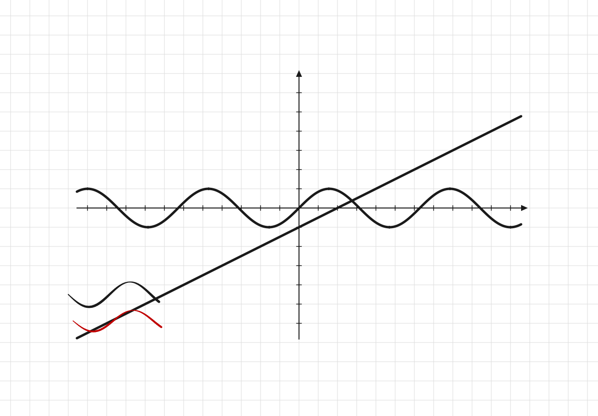

# Doska (Доска)

A lightweight cross-platform whiteboard app (Windows 10 / macOS) built with
PySide6, in the spirit of OpenBoard: a big canvas with a grid background,
full graphics-tablet support, math-oriented tools and image embedding.



## Features

- **Large workspace** — 16000×12000 canvas; the view starts centered.
  Pan by dragging empty space with the right mouse button;
  zoom with Ctrl + mouse wheel (anchored to the cursor); Ctrl+0 resets to center.
- **Pen & tablet support** — pressure-sensitive strokes with smoothing;
  on tablets (e.g. Wacom Intuos) the back end of the pen erases.
- **Eraser** — radius erasing instead of whole-line removal; radius grows
  with pen speed.
- **Straight lines & arrows** — hold Shift for a straight line, hold Q for a
  line with an arrow tip; add Ctrl to snap the ends to grid nodes.
- **Dashed lines** — the «Пунктир» toggle affects lines, circles and graphs.
- **Circles** — built by center + a point on the circle; the center is drawn
  too (and can be deleted); Ctrl snaps center and radius to grid nodes.
- **Coordinate axes** — one click draws axes aligned to the background grid.
- **Graphs & formulas** — plot `y = f(x)` formulas (`x^2`, `sin(x)`, …)
  and implicit equations (e.g. a circle `x^2+y^2=25`).
- **Text & LaTeX** — labels with several font sizes, plain text or LaTeX.
- **Images** — paste from clipboard with Ctrl+V, draw on top of them,
  resize proportionally, rotate with 90° snapping, delete with Del.
- **Selection** — left button can be switched (button «ЛКМ: …», hotkey M)
  between drawing and selection/move mode; selected entries can be moved,
  deleted (Del), copied (Ctrl+C) and pasted (Ctrl+V) — pasted copies never
  overlap the originals.
- **Undo / Redo** — Ctrl+Z / Ctrl+Y, including move, resize and rotate.
- **Export** — save the visible area to PNG with Ctrl+S.
- **Help** — F1 shows the full feature and hotkey list.

## Download

Prebuilt binaries are on the
[Releases](https://github.com/olegrenev/doska/releases) page:

- **Windows** — `Doska-3.1.exe`, a single portable file, just run it.
- **macOS** — `Doska-3.1-macos.zip`. Unzip, then right-click the app →
  Open (or run `xattr -dr com.apple.quarantine Doska-3.1.app`), because the
  app is not notarized. Intel build; runs on Apple Silicon via Rosetta 2.

## Build from source

Requirements: Python 3.10+, PySide6, PyInstaller.

```bash
pip install PySide6 pyinstaller

# Windows
pyinstaller --noconfirm --onefile --windowed --name "Doska-3.1" \
    --icon doska_icon.ico --add-data "doska_icon.ico;." doska_qt.py

# macOS (note the ':' separator in --add-data)
pyinstaller --noconfirm --onefile --windowed --name "Doska-3.1" \
    --add-data "doska_icon.ico:." doska_qt.py
```

## Tests

```bash
python test_doska.py
```

Runs 256 headless checks (Qt offscreen platform).

## License

MIT — see [LICENSE](LICENSE).

## Code signing policy

Free code signing provided by [SignPath.io](https://signpath.io),
certificate by SignPath Foundation — **application pending**.

Until the application is approved, Windows binaries are unsigned and
SmartScreen may show an "Unknown publisher" warning (More info →
Run anyway).

- **What will be signed:** `Doska-*.exe` published on GitHub Releases.
- **Build & signing:** artifacts are built from this repository with
  GitHub Actions / PyInstaller; only CI-built artifacts are submitted for
  signing; the private key is held by SignPath (HSM-backed) and never
  stored in this project.
- **Roles (single maintainer):** author, reviewer and signing approver —
  [@olegrenev](https://github.com/olegrenev). External pull requests are
  reviewed before merge; every signing request requires manual approval.

## Privacy

Doska does not collect, store or transfer any user data. It runs fully
offline; nothing is sent over the network.

---

# Doska (Доска) — по-русски

Лёгкая кроссплатформенная доска (Windows 10 / macOS) на PySide6 в духе
OpenBoard: большое поле с фоном в клетку, полная поддержка графических
планшетов, инструменты для математики и вставка изображений.

## Возможности

- **Большая рабочая область** — 16000×12000, по умолчанию экран показывает
  центр. Перемещение — зажатой правой кнопкой по пустому месту, масштаб —
  Ctrl + колёсико (привязка к курсору), Ctrl+0 — вернуться к центру.
- **Перо и планшет** — толщина зависит от нажатия, штрихи сглаживаются;
  задний конец пера Wacom стирает.
- **Ластик** — стирает в радиусе, а не всю линию; чем быстрее движение пера,
  тем больше радиус.
- **Линии и стрелки** — Shift — прямая линия, зажатая Q — отрезок со
  стрелкой; Ctrl дополнительно прилипает концы к узлам сетки.
- **Пунктир** — переключатель действует на линии, окружности и графики.
- **Окружности** — по центру и точке; центр рисуется и его можно удалить;
  Ctrl прилипает центр и радиус к узлам сетки.
- **Оси координат** — одна кнопка, привязка к фоновой сетке.
- **Графики** — по формуле `y = f(x)` (в т.ч. `x^2`, `sin(x)`) и по
  уравнениям (например, окружность `x^2+y^2=25`).
- **Текст и LaTeX** — надписи с выбором размера, обычный текст или LaTeX.
- **Изображения** — вставка из буфера по Ctrl+V, рисование поверх,
  пропорциональное изменение размера, поворот с прилипанием к 90°, удаление
  по Del.
- **Выделение** — левая кнопка переключается (кнопка «ЛКМ: …», клавиша M)
  между рисованием и выделением/перемещением; выделенное можно двигать,
  удалять (Del), копировать (Ctrl+C) и вставлять (Ctrl+V).
- **Отмена / повтор** — Ctrl+Z / Ctrl+Y (включая перенос, размер и поворот).
- **Экспорт** — Ctrl+S сохраняет видимую область в PNG.
- **Справка** — F1 — полный список возможностей и горячих клавиш.

## Загрузка

Готовые сборки — на странице
[Releases](https://github.com/olegrenev/doska/releases):

- **Windows** — `Doska-3.1.exe`, один портативный файл, просто запустите.
- **macOS** — `Doska-3.1-macos.zip`. Распакуйте и откройте через
  правый клик → Открыть (или `xattr -dr com.apple.quarantine Doska-3.1.app`),
  т.к. приложение без нотаризации. Intel-сборка, на Apple Silicon работает
  через Rosetta 2.

## Сборка из исходников

Нужны Python 3.10+, PySide6, PyInstaller — команды см. в английском разделе
выше (они одинаковые для обоих языков).

## Тесты

```bash
python test_doska.py
```

256 проверок без открытия окна (Qt offscreen).

## Лицензия

MIT — см. [LICENSE](LICENSE).

## Подпись кода

Заявка на бесплатную подпись через SignPath Foundation подана
(см. английский раздел выше). Пока exe не подписан, SmartScreen может
показывать предупреждение «Неизвестный издатель».

## Конфиденциальность

Doska не собирает и никуда не передаёт данные пользователя, работает
полностью офлайн.
